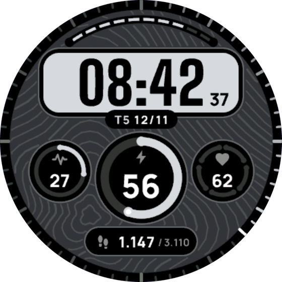

# Wellface



A custom Connect IQ watch face for round AMOLED Garmin watches. Every element sits inside a black well, hence the name: a well, and wellness. Colors come from a theme, so nothing in the code is tied to one color.

The project is developed with Claude Code. Garmin, Forerunner and Connect IQ are trademarks of Garmin Ltd. or its subsidiaries; Wellface is not affiliated with Garmin.

## What it shows

- The time as `08:42` in a large condensed font on a wide band, and the seconds while the screen is awake. The time is always 24-hour.
- A date pill with the weekday (in the watch language) and `dd/mm`.
- Three round fields: stress, Body Battery (large, in the middle) and heart rate as five zone segments.
- A bottom pill with today's steps and the step goal, read from the watch.
- A bezel ring of 60 ticks that fill up with step progress, and a ten-segment battery bar at the top.
- Topographic contour lines on the background, visible only between the wells.
- Ten themes (Mint, Volt, Sage, Aqua, Glacier, Steel, Periwinkle, Lavender, Orchid, Platinum), each a single accent color. The screenshot uses Platinum.
- Warning colors for high stress, low Body Battery and low battery.
- An Always On mode that draws only the time and the date, dimmed, and moves them a few pixels each minute to limit burn-in.
- Long-pressing a field opens the matching Garmin page.

The design is in [`design/claude-design/`](design/claude-design/); [`docs/decisions.md`](docs/decisions.md) records every agreed design decision, and [`GLOSSARY.md`](GLOSSARY.md) the vocabulary.

## Status and supported devices

Wellface is a community project with one maintainer. It is not on the Connect IQ Store; you install it by sideloading a `.prg` file over USB. It has no settings page in the phone app: the theme and the metric in each field are set in code (`FaceConfigs.defaultConfig` in `source/FaceConfig.mc`).

| Device | Screen | Support | Notes |
| --- | --- | --- | --- |
| Garmin Forerunner 265 | 416×416 AMOLED | Maintained | The only device the maintainer owns and tests on |

There are no community devices yet. How a device gets added is in [`CONTRIBUTING.md`](CONTRIBUTING.md#device-support). Support for other devices is planned only as far as it stays additive: a port must not change a single pixel on the Forerunner 265.

## Install on a watch

Download `wellface-<device>.prg` from the latest [release](https://github.com/fugo101/wellface/releases) and copy it into `GARMIN/Apps` on the watch over USB; the release notes have the steps, including how to remove the face. Building it yourself needs your own developer key, as described below.

## Build, test and sideload

You need:

- a JDK (the SDK needs 11 or later);
- the Connect IQ SDK and the Forerunner 265 device files, both from the [Connect IQ SDK Manager](https://developer.garmin.com/connect-iq/sdk/) (needs a free Garmin account);
- a developer key you generate yourself (RSA 4096, DER), kept outside the repo and pointed to by `CIQ_DEV_KEY`. Never commit it.

The Garmin SDK, device files and fonts are not in this repository and must not be added to it.

```sh
export CIQ_DEV_KEY="<path to your developer key>"
scripts/run-tests.sh      # unit tests, run in the simulator
scripts/run-sim.sh        # debug build, loaded into the simulator
scripts/sideload.sh       # release build, copied to a watch over USB
```

[`docs/build.md`](docs/build.md) has every script, the font and contour generators, simulator and Always On checks, profiling and the sideload steps. The scripts are developed and verified on macOS; other systems are untested.

## Documentation

| Where | What |
| --- | --- |
| [`docs/spec.md`](docs/spec.md) | What the face does and how the code is shaped |
| [`docs/decisions.md`](docs/decisions.md) | Agreed design decisions |
| [`docs/research/connect-iq-platform.md`](docs/research/connect-iq-platform.md) | Verified Connect IQ platform facts for the Forerunner 265, with sources |
| [`docs/design-sync.md`](docs/design-sync.md) | Where the built face differs from the design |
| [`CODING_STANDARDS.md`](CODING_STANDARDS.md) | The rules reviewers hold changes to |

## Contributing

Issues and pull requests are welcome; see [`CONTRIBUTING.md`](CONTRIBUTING.md). Everyone follows the [Code of Conduct](CODE_OF_CONDUCT.md). Report vulnerabilities privately as described in [`SECURITY.md`](SECURITY.md). For questions, see [`SUPPORT.md`](SUPPORT.md).

## License

Apache-2.0. See [`LICENSE`](LICENSE) and [`NOTICE`](NOTICE). The bitmap fonts are under the SIL Open Font License 1.1, and `design/claude-design/support.js` is not part of the project's work; `NOTICE` has the details.
